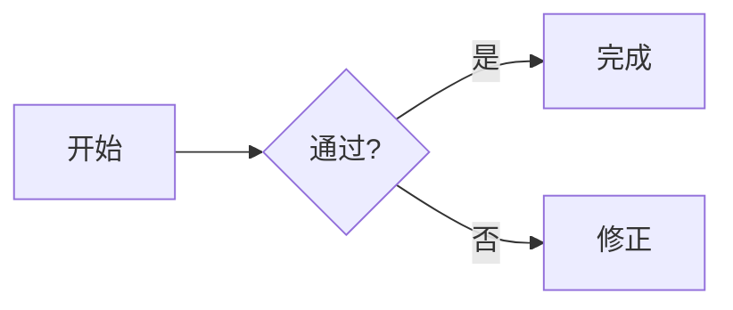

# MyFumadocs · Markdown 与官方组件（稳定篇）

本 Skill 用于在 Fumadocs 中创建、整理、改写 `.md` / `.mdx` 文档。**本文件仅维护通用 Markdown 与 Fumadocs 官方能力**；两个站点的自定义组件单独维护在 [自定义组件与实例](references/custom-components.md)。写普通教程时只读本篇；涉及题目、阅读、单词卡、思维导图时再读取后者。

## 最高优先级：数学公式统一使用美元符号

- **行内公式只能写** `$...$`：例如 `$f(x)=x^2$`、`$\lim_{x\to0}\frac{\sin x}{x}=1$`。
- **独立公式只能写** `$$...$$`：推荐前后留空行，公式内容独占一行。
- **严禁用** `\( ... \)`、`\[ ... \]` **作为数学定界符**；不要把公式改成截图、HTML、普通代码或省略反斜线。
- 数学源代码保留原始 LaTeX 命令 `\frac`、`\sum`、`\begin{aligned}` 等；长推导优先 `aligned`，不要把代码中的美元符号（例如价格）误当成公式。
- 渲染取决于目标工程是否配置 `remark-math` / `rehype-katex`；`exam-docs` 已配置，`fumadocs-study` 请以当前 `source.config.ts` 为准。**MySkills 自己是否渲染数学公式不影响本 Skill 对目标文档的要求。**

~~~mdx
设 $f(x)=x^2$，则 $f'(x)=2x$。

$$
\int_0^1 x^2\,\mathrm{d}x=\frac{1}{3}
$$

$$
\begin{aligned}
(a+b)^2 &= a^2+2ab+b^2\\
(a-b)^2 &= a^2-2ab+b^2
\end{aligned}
$$
~~~

## 普通 Markdown / MDX 速查（简要）

| 能力 | 写法 |
| --- | --- |
| 页面元数据 | 文件开头 `---` / `title: 标题` / `description: 简介` / `---`；页面主标题通常由 frontmatter 渲染，不必再写重复的 `#` |
| 标题 | `## 二级`、`### 三级`，自动生成目录与锚点；`[#custom-id]` 自定义锚点；`[!toc]` 从目录隐藏 |
| 加粗、斜体、删除线 | `**粗体**`、`*斜体*`、`~~删除~~` |
| 下划线 | `<u>下划线</u>` 或 `<ins>新增</ins>`（Markdown 本身无统一下划线语法） |
| 链接、图片 | `[文本](/docs/path)`、`` |
| 引用、分隔线 | `> 引用文字`；`---` |
| 列表、任务 | `- 项`、`1. 项`、`- [ ] 未完成` |
| 表格 | GFM 管道表格 `| 列一 | 列二 |` 与分隔行 `| --- | --- |` |
| 行内代码、代码块 | ``code``；三反引号围栏并在开头指定 `ts`、`js`、`bash` 等语言 |
| Mermaid | ````mermaid` 围栏内写 `flowchart TD`、`sequenceDiagram` 等（目标工程须启用 Mermaid 插件） |
| HTML / JSX | `<kbd>Ctrl</kbd>`、`<Component prop="value" />`；复杂交互用 MDX 而不是普通 `.md` |
| 注释 | 在 MDX 用 `{/* 注释 */}`；避免在 JSX 中写非法 HTML 标签 |

~~~mdx

~~~

> Mermaid 是流程图，**不是** Markmap 思维导图。后者属于 `fumadocs-study` 自定义 `MindMap`，见动态篇。Mermaid 本身需要工程集成：官方文档并未提供不经配置就能使用的通用内置渲染器。

## 官方特色组件（重点）

**组件使用前先看当前工程的 `components/mdx.tsx` 映射。** `exam-docs` 与 `fumadocs-study` 已全局注册 `Accordion/Accordions`、`Step/Steps`、`Tab/Tabs`、`TypeTable`，Fumadocs 默认提供 `Callout`、`Card/Cards` 等。它们在这两个项目的 MDX 中通常无需每页导入。未注册的组件不可仅靠书写 JSX 生效。

### 1. Accordion / Accordions · 可折叠知识点、FAQ

`Accordions` 是容器，`Accordion` 是每个折叠项。适合可选解释、易错点、长证明。`title` 设置标题，`id` 可被 `#锚点` 定位。

~~~mdx
<Accordions>
  <Accordion title="为什么需要虚拟内存？" id="vm-why">

    虚拟内存提供地址空间隔离，并允许按需调页。

    - 地址转换
    - 页面置换
  </Accordion>
  <Accordion title="缺页中断是什么？">

    页面不在内存时触发的异常处理流程。
  </Accordion>
</Accordions>
~~~

官方还提供单/多项展开相关配置；具体以当前安装的 Fumadocs/Base UI 版本为准。不要把 `Accordion` 单独当成容器。参考：https://www.fumadocs.dev/docs/ui/components/accordion

### 2. Auto Type Table · 从 TypeScript 类型自动生成字段文档

`AutoTypeTable` **不等于** `TypeTable`。它属于单独的 `fumadocs-typescript` 包，使用 TypeScript 编译器分析类型，适合 API、类型定义变化频繁的工程。**两个现有站点当前全局组件映射不含 `AutoTypeTable`，必须先安装并注册，再使用以下写法。**

~~~bash
npm install fumadocs-typescript
~~~

在站点 `components/mdx.tsx` 中根据官方文档使用 `createGenerator` + `AutoTypeTable` 注册到 MDX 映射（服务端组件，不能直接放进客户端组件）；然后：

~~~mdx
<AutoTypeTable path="src/types/config.ts" name="ConfigOptions" />

<AutoTypeTable type="{ enabled: boolean; retry?: number }" />
~~~

`path` 使用的是项目根目录（cwd）相对路径，不一定是 MDX 文件相对路径。若改用 `remarkAutoTypeTable` 的构建期插件，写法为小写 `<auto-type-table ... />`，相对路径和属性规则也不同；不要混用。参考：https://www.fumadocs.dev/docs/ui/components/auto-type-table 和 https://www.fumadocs.dev/docs/markdown/typescript

### 3. Code Block · 代码高亮、标题、行号、差异与代码 Tabs

常规首选 **Markdown 代码围栏**，Fumadocs 通过 Rehype/Shiki 处理，不必逐段手写 JSX。可加 `title`、`lineNumbers`、`[!code highlight]`、`[!code ++]` / `[!code --]`；连续相邻且带 `tab="..."` 的围栏可自动合为语言切换组。

~~~mdx
```ts title="src/example.ts" lineNumbers
const answer = 42; // [!code highlight]
console.log(answer);
```

```bash tab="npm"
npm install
```
```bash tab="pnpm"
pnpm install
```
~~~

底层组件是 `CodeBlock` / `Pre`；它们一般在 `components/mdx.tsx` 中通过 `pre` 映射包装，不应凭空写一个未导入、未注册的 `<CodeBlock>`。以上代码 Tabs 与下面的内容 `Tabs` 不是一回事。参考：https://www.fumadocs.dev/docs/ui/components/codeblock 和 https://www.fumadocs.dev/docs/markdown

### 4. Steps / Step · 分阶段教程

~~~mdx
<Steps>
  <Step>

    ### 安装依赖

    执行 `npm install`。
  </Step>
  <Step>

    ### 配置项目

    修改 `source.config.ts`。
  </Step>
  <Step>

    ### 验证结果

    运行构建并检查页面。
  </Step>
</Steps>
~~~

每步写清标题与正文；步骤标题优先在 `Step` 内使用三级标题。适合算法过程、软件操作流程。参考：https://www.fumadocs.dev/docs/ui/components/steps

### 5. Tabs / Tab · 同位置切换不同实现或语言

~~~mdx
<Tabs items={['Python', 'JavaScript']} defaultIndex={0}>
  <Tab value="Python">

    ```python
    print("hello")
    ```
  </Tab>
  <Tab value="JavaScript">

    ```js
    console.log("hello");
    ```
  </Tab>
</Tabs>
~~~

- `items` 定义标签；每个 `Tab value` 对应其中一项；尽量显式写 `value`，避免动态列表索引错位。
- 多组 Tabs 用相同的 `groupId` 共享选择，添加 `persist` 允许本地持久化；`defaultIndex={1}` 指定默认项。
- `Tab id="tab-js"` 可以提供锚点，`Tabs updateAnchor` 会随切换更新地址栏。
- **Tabs 是整段 MDX 内容切换**；只有代码时，用前面的 `tab="..."` 围栏更简洁。

参考：https://www.fumadocs.dev/docs/ui/components/tabs

### 6. Type Table · 手动描述参数、数据结构或配置项

不需要从 TypeScript 类型自动推导时，直接用 **已全局注册的** `TypeTable`，显式维护字段说明，适用于公开 API、配置参数、Props、数据结构。

~~~mdx
<TypeTable
  type={{
    timeout: {
      type: 'number',
      description: '超时时长（毫秒）',
      default: 5000,
    },
    enabled: {
      type: 'boolean',
      description: '是否启用',
      required: true,
    },
    mode: {
      type: '"fast" | "safe"',
      description: '工作模式',
    },
  }}
/>
~~~

常用条目属性：`type`、`description`、`default`、`required`、`deprecated`、`parameters`、`returns`。区别：**TypeTable 是手动数据，AutoTypeTable 是自动类型分析**。参考：https://www.fumadocs.dev/docs/ui/components/type-table

### 其他官方组件（了解即可）

- `<Callout type="warn" title="注意">正文</Callout>`：提示/警告；可用 `info`、`warn`、`error`、`success`、`idea`。
- `<Cards><Card title="章节" href="/docs/chapter">简介</Card></Cards>`：章节入口与链接卡片。
- `Files` 族组件可展示文件树，需在当前工程映射中启用；本项目已引入。
- 图片、SVG：优先 Markdown 图片引用，保持可访问的 `alt`，避免无谓转换为截图。

## 输出前检查

1. 数学公式是否全用 `$...$` / `$$...$$`，LaTeX 命令与成对定界符是否完整？
2. MDX 标签有无闭合，JSX 属性是字符串还是表达式，组件是否已经注册？
3. 有没有把 `AutoTypeTable` 错当成已经启用，或者把代码块 `tab` 与内容 `Tabs` 混淆？
4. 是否保留原图片、SVG、链接的相对路径，Mermaid 语法与插件是否匹配？
5. 写入 `exam-docs` / `fumadocs-study` 的私有组件内容之前，是否额外读取了 [自定义组件动态篇](references/custom-components.md)？

## 来源与维护边界

- 官方 Markdown：https://www.fumadocs.dev/docs/markdown
- 官方组件：https://www.fumadocs.dev/docs/ui/components
- 自定义组件：[`references/custom-components.md`](references/custom-components.md)
- 目标源码：`ActiveInsighter/exam-docs` 的 `components/mdx.tsx`、`docs/question-components.md`、`docs/english-reading-component.md`；`ActiveInsighter/fumadocs-study` 的 `components/mdx.tsx` 等。
- **稳定篇**主要随 Fumadocs 官方 API 更新；**动态篇**必须在自定义组件 API 改动时单独校对，示例以当前源码而非旧文章为准。
