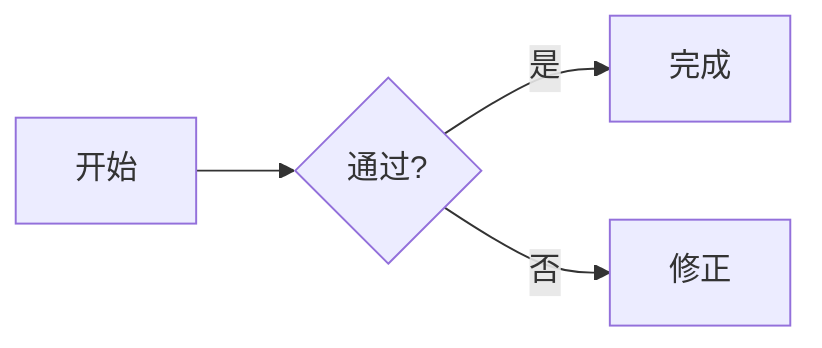

# MyFumadocs · Markdown / MDX 与官方组件

编写 Fumadocs 文档时直接使用下列语法和组件。Exam Docs 题目组件、Study Docs 思维导图和单词卡见 [自定义组件](references/custom-components.md)。

## 数学公式

- **行内公式只能写** `$...$`：例如 `$f(x)=x^2$`、`$\lim_{x\to0}\frac{\sin x}{x}=1$`。
- **独立公式只能写** `$$...$$`：推荐前后留空行，公式内容独占一行。
- **严禁用** `\( ... \)`、`\[ ... \]` **作为数学定界符**；不要把公式改成截图、HTML、普通代码或省略反斜线。
- 数学源代码保留原始 LaTeX 命令 `\frac`、`\sum`、`\begin{aligned}` 等；长推导优先 `aligned`，不要把代码中的美元符号（例如价格）误当成公式。
- 数学渲染使用 `remark-math` 与 `rehype-katex`。

~~~mdx
设 $f(x)=x^2$，则 $f'(x)=2x$。

$$
\int_0^1 x^2\,\mathrm{d}x=\frac{1}{3}
$$

$$
\begin{aligned}
(a+b)^2 &= a^2+2ab+b^2\\
(a-b)^2 &= a^2-2ab+b^2
\end{aligned}
$$
~~~

## Markdown / MDX

| 能力 | 写法 |
| --- | --- |
| 页面元数据 | 文件开头 `---` / `title: 标题` / `description: 简介` / `---`；页面主标题通常由 frontmatter 渲染，不必再写重复的 `#` |
| 标题 | `## 二级`、`### 三级`，自动生成目录与锚点；`[#custom-id]` 自定义锚点；`[!toc]` 从目录隐藏 |
| 加粗、斜体、删除线 | `**粗体**`、`*斜体*`、`~~删除~~` |
| 下划线 | `<u>下划线</u>` 或 `<ins>新增</ins>`（Markdown 本身无统一下划线语法） |
| 链接、图片 | `[文本](/docs/path)`、`` |
| 引用、分隔线 | `> 引用文字`；`---` |
| 列表、任务 | `- 项`、`1. 项`、`- [ ] 未完成` |
| 表格 | GFM 管道表格 `| 列一 | 列二 |` 与分隔行 `| --- | --- |` |
| 行内代码、代码块 | ``code``；三反引号围栏并在开头指定 `ts`、`js`、`bash` 等语言 |
| Mermaid | ````mermaid` 围栏内写 `flowchart TD`、`sequenceDiagram` 等（目标工程须启用 Mermaid 插件） |
| HTML / JSX | `<kbd>Ctrl</kbd>`、`<Component prop="value" />`；复杂交互用 MDX 而不是普通 `.md` |
| 注释 | 在 MDX 用 `{/* 注释 */}`；避免在 JSX 中写非法 HTML 标签 |

~~~mdx

~~~

Mermaid 用于流程图；Study Docs 交互思维导图使用 [`MindMap`](references/custom-components.md)。使用 Mermaid 前启用相应渲染插件。

## 官方组件

Exam Docs 与 Study Docs 已全局注册 `Accordion`、`Steps`、`Tabs`、`TypeTable`、`Files` 等组件，MDX 页面直接写下列 JSX 即可。`AutoTypeTable` 等扩展按对应小节安装。

### 1. Accordion / Accordions · 可折叠知识点、FAQ

`Accordions` 是容器，`Accordion` 是每个折叠项。适合可选解释、易错点、长证明。`title` 设置标题，`id` 可被 `#锚点` 定位。

~~~mdx
<Accordions>
  <Accordion title="为什么需要虚拟内存？" id="vm-why">

    虚拟内存提供地址空间隔离，并允许按需调页。

    - 地址转换
    - 页面置换
  </Accordion>
  <Accordion title="缺页中断是什么？">

    页面不在内存时触发的异常处理流程。
  </Accordion>
</Accordions>
~~~

需要多项时用 `Accordions` 包裹 `Accordion`。参考：https://www.fumadocs.dev/docs/ui/components/accordion

### 2. Auto Type Table · 从 TypeScript 类型自动生成字段文档

`AutoTypeTable` **不等于** `TypeTable`。它属于单独的 `fumadocs-typescript` 包，使用 TypeScript 编译器分析类型，适合 API、类型定义变化频繁的工程。先安装 `fumadocs-typescript` 并注册该组件。

~~~bash
npm install fumadocs-typescript
~~~

在 `components/mdx.tsx` 中用 `createGenerator` 和 `AutoTypeTable` 注册服务端组件，之后：

~~~mdx
<AutoTypeTable path="src/types/config.ts" name="ConfigOptions" />

<AutoTypeTable type="{ enabled: boolean; retry?: number }" />
~~~

`path` 使用的是项目根目录（cwd）相对路径，不一定是 MDX 文件相对路径。若改用 `remarkAutoTypeTable` 的构建期插件，写法为小写 `<auto-type-table ... />`，相对路径和属性规则也不同；不要混用。参考：https://www.fumadocs.dev/docs/ui/components/auto-type-table 和 https://www.fumadocs.dev/docs/markdown/typescript

### 3. Code Block · 代码高亮、标题、行号、差异与代码 Tabs

常规首选 **Markdown 代码围栏**，Fumadocs 通过 Rehype/Shiki 处理，不必逐段手写 JSX。可加 `title`、`lineNumbers`、`[!code highlight]`、`[!code ++]` / `[!code --]`；连续相邻且带 `tab="..."` 的围栏可自动合为语言切换组。

~~~mdx
```ts title="src/example.ts" lineNumbers
const answer = 42; // [!code highlight]
console.log(answer);
```

```bash tab="npm"
npm install
```
```bash tab="pnpm"
pnpm install
```
~~~

代码围栏由 `pre` 映射渲染；代码 Tabs 使用 `tab`，内容切换使用 `Tabs`。参考：https://www.fumadocs.dev/docs/ui/components/codeblock 和 https://www.fumadocs.dev/docs/markdown

### 4. Steps / Step · 分阶段教程

~~~mdx
<Steps>
  <Step>

    ### 安装依赖

    执行 `npm install`。
  </Step>
  <Step>

    ### 配置项目

    修改 `source.config.ts`。
  </Step>
  <Step>

    ### 验证结果

    运行构建并检查页面。
  </Step>
</Steps>
~~~

每步写清标题与正文；步骤标题优先在 `Step` 内使用三级标题。适合算法过程、软件操作流程。参考：https://www.fumadocs.dev/docs/ui/components/steps

### 5. Tabs / Tab · 同位置切换不同实现或语言

~~~mdx
<Tabs items={['Python', 'JavaScript']} defaultIndex={0}>
  <Tab value="Python">

    ```python
    print("hello")
    ```
  </Tab>
  <Tab value="JavaScript">

    ```js
    console.log("hello");
    ```
  </Tab>
</Tabs>
~~~

- `items` 定义标签；每个 `Tab value` 对应其中一项；尽量显式写 `value`，避免动态列表索引错位。
- 多组 Tabs 用相同的 `groupId` 共享选择，添加 `persist` 允许本地持久化；`defaultIndex={1}` 指定默认项。
- `Tab id="tab-js"` 可以提供锚点，`Tabs updateAnchor` 会随切换更新地址栏。
- **Tabs 是整段 MDX 内容切换**；只有代码时，用前面的 `tab="..."` 围栏更简洁。

参考：https://www.fumadocs.dev/docs/ui/components/tabs

### 6. Type Table · 手动描述参数、数据结构或配置项

用 `TypeTable` 描述 API 参数、配置字段、Props 和数据结构。

~~~mdx
<TypeTable
  type={{
    timeout: {
      type: 'number',
      description: '超时时长（毫秒）',
      default: 5000,
    },
    enabled: {
      type: 'boolean',
      description: '是否启用',
      required: true,
    },
    mode: {
      type: '"fast" | "safe"',
      description: '工作模式',
    },
  }}
/>
~~~

常用条目属性：`type`、`description`、`default`、`required`、`deprecated`、`parameters`、`returns`。区别：**TypeTable 是手动数据，AutoTypeTable 是自动类型分析**。参考：https://www.fumadocs.dev/docs/ui/components/type-table

### 7. Cards / Card · 信息卡片、章节入口与图标网格

`Cards` 是卡片布局容器，`Card` 是单个卡片。适合首页导航、章节入口、术语介绍、知识点概览和资源推荐。不设置 `href` 可用于纯展示。

用 `<Cards>` 包裹多个 `<Card>`；`title` 是标题，`href` 是可选链接，不提供则为展示卡片。

~~~mdx
<Cards>
  <Card title="计算机组成原理" href="/docs/computer-organization">
    存储系统、指令系统、CPU 与总线。
  </Card>
  <Card title="操作系统" href="/docs/operating-system">
    进程、内存管理、文件系统与 I/O。
  </Card>
  <Card title="复习提示">
    本卡片仅用于展示信息，没有链接，不可点击跳转。
  </Card>
  <Card title="Fumadocs 官方文档" href="https://www.fumadocs.dev/docs">
    访问外部文档。
  </Card>
</Cards>
~~~

`icon` 接收 React 节点，可使用 `lucide-react` 图标：

~~~mdx
import { BookOpenIcon, DatabaseIcon, TerminalIcon } from 'lucide-react';

<Cards>
  <Card title="Fumadocs Core" icon={<DatabaseIcon />}>
    负责文档数据源、搜索与 Markdown 扩展。
  </Card>
  <Card title="Fumadocs UI" icon={<BookOpenIcon />}>
    提供文档主题与 UI 组件。
  </Card>
  <Card title="Fumadocs CLI" icon={<TerminalIcon />} href="/docs/cli">
    打开命令行工具相关文档。
  </Card>
</Cards>
~~~

常用属性：`title`、`href`、`icon`、`children`。

- **导航卡片**：设置 `href`，内部链接使用站点实际路径，外链使用完整的 `https://` URL。
- **知识点/术语卡片**：不设置 `href`，可配图标和简短解释；截图中的 Terminology 卡片属于这一类。
- **多卡片布局**：用同一个 `Cards` 容器装多个 `Card`；不要套用其他 UI 库中不存在于 Fumadocs 的 `CardHeader`、`CardContent` 等子组件。
- 卡片正文可包含简短的 Markdown/MDX；复杂长篇推导优先使用正文、`Accordion` 或 `Tabs`，避免卡片高度差异过大。

官方参考：https://www.fumadocs.dev/docs/markdown#cards

### 8. Callout · 提示、注意、警告、错误与学习建议

`Callout` 是 Fumadocs **默认内置的提示框组件**，适合强调一段内容，而不是将普通引用块（`>`）当作有语义的警告。使用 `title` 指定标题、`type` 选择语义和对应主题样式；省略 `type` 默认是 `info`。

| `type` | 含义 | 典型用途 |
| --- | --- | --- |
| `info`（默认） | 信息、补充说明 | 定义、前置条件、教材补充 |
| `warn` / `warning` | 注意、警告 | 易错点、风险和限制条件 |
| `error` | 错误、禁止事项 | 常见错误结论、不可用配置 |
| `success` | 正确、完成 | 验证成功、正确做法 |
| `idea` | 灵感、技巧 | 解题技巧、拓展思路 |

示例：

~~~mdx
<Callout>
  这是一条没有显式标题的默认信息提示。
</Callout>

<Callout type="info" title="知识点提示">
  先理解定义，再记忆常用结论。
</Callout>

<Callout type="warn" title="易错点">
  注意区分 **缺页中断** 与 **TLB 未命中**，两者不等价。
</Callout>

<Callout type="error" title="错误结论">
  不要认为所有 TLB 未命中都会访问磁盘。
</Callout>

<Callout type="success" title="正确做法">
  先判断页表项是否有效，再确认目标页是否驻留内存。
</Callout>

<Callout type="idea" title="解题技巧">
  绘制地址转换流程图，按顺序列出每次访问。
</Callout>
~~~

`Callout` 支持 Markdown、列表和公式；嵌套块内容前后留空行：

~~~mdx
<Callout type="warn" title="复习前检查">

  - 明确页号、页内偏移量的划分。
  - 区分页表访问与实际数据访问。
  - 判断题目是否明确给出 TLB 命中情况。

</Callout>
~~~

**用法建议**：定义性补充用 `info`，重点陷阱用 `warn`，错误配置或错误推论用 `error`，确认正确的操作用 `success`，解题捷径用 `idea`。不要仅为装饰而整页堆叠警告框；具体颜色、边框和图标随站点主题与 Fumadocs 版本而变化，不要假设固定颜色。

官方参考：https://www.fumadocs.dev/docs/markdown#callouts

### 9. Files / Folder / File · 可折叠文件树与项目目录结构

`Files` 是文件树容器，`Folder` 表示目录，`File` 表示文件。适合展示项目目录、模块布局、示例工程结构和文件用途；目录可以展开、收起。

**MDX 组件写法：**

~~~mdx
<Files>
  <Folder name="app" defaultOpen>
    <File name="layout.tsx" />
    <File name="page.tsx" />
    <Folder name="api">
      <File name="route.ts" />
    </Folder>
  </Folder>
  <Folder name="components">
    <File name="button.tsx" />
    <File name="tabs.tsx" />
  </Folder>
  <File name="package.json" />
</Files>
~~~

Exam Docs、Study Docs 可直接使用这些组件。其他站点需先从 `fumadocs-ui/components/files` 导入或在 MDX 映射中注册。

**常用属性：**

| 组件 | 属性 | 用途 |
| --- | --- | --- |
| `Files` | `children` | 包裹根目录、目录及文件节点 |
| `Folder` | `name`（必填） | 目录名，支持嵌套 `Folder` / `File` |
| `Folder` | `defaultOpen`（可选） | 初始展开该目录；省略时默认折叠 |
| `Folder` | `disabled`（可选） | 禁用目录交互；仅在确有需求时使用 |
| `File` | `name`（必填） | 文件名，通常自闭合 |
| `File` | `icon`（可选） | 传入 React 节点以自定义图标，需先导入对应图标组件 |

**`files` 代码围栏：**要转换树形文本，在 `source.config.ts` 中启用 `remark-mdx-files`：

~~~ts
import { remarkMdxFiles } from "fumadocs-core/mdx-plugins/remark-mdx-files";
import { defineConfig } from "fumadocs-mdx/config";

export default defineConfig({
  mdxOptions: {
    remarkPlugins: [remarkMdxFiles],
  },
});
~~~

然后在 MDX 中使用以下围栏；构建时插件会将目录文本转换为 `Files` 组件：

~~~mdx
```files
my-project
├── app
│   ├── layout.tsx
│   └── page.tsx
├── components
│   └── button.tsx
└── package.json
```
~~~

同一插件支持 `<auto-files>` 自动读取目录：

~~~mdx
<auto-files dir="./my-dir" pattern="**/*.{ts,tsx}" />
<auto-files dir="./my-dir" pattern="**/*.{ts,tsx}" defaultOpenAll />
~~~

`dir` 与 `pattern` 指向构建时可访问的文件路径；`files` 围栏和 `<auto-files>` 需要 `remarkMdxFiles`。

**CLI 生成文件树：**

~~~bash
npx @fumadocs/cli tree ./my-dir ./files.mdx
~~~

生成 `<Files>` MDX 结构，可直接编辑。

文件与目录分别用 `File`、`Folder`；要初始展开目录，设置 `defaultOpen`。普通 `.md` 文件需经过 MDX 编译才能渲染 JSX。

官方参考：https://www.fumadocs.dev/docs/ui/components/files；CLI：https://www.fumadocs.dev/docs/cli
### 其他官方组件（了解即可）
- 图片、SVG：优先 Markdown 图片引用，保持可访问的 `alt`，避免无谓转换为截图。

## 输出前检查

1. 数学公式是否全用 `$...$` / `$$...$$`，LaTeX 命令与成对定界符是否完整？
2. MDX 标签有无闭合，JSX 属性是字符串还是表达式，组件是否已经注册？
3. 有没有把 `AutoTypeTable` 错当成已经启用，或者把代码块 `tab` 与内容 `Tabs` 混淆？
4. 是否保留原图片、SVG、链接的相对路径，Mermaid 语法与插件是否匹配？
5. `Card` 的 `href` 可选，`Callout` 使用有效的 `type`，图标组件已经导入或注册？
6. `Files`、`Folder`、`File` 已导入或映射？使用 `files` 围栏或 `<auto-files>` 时，`remarkMdxFiles` 是否已启用？
7. 写入 `exam-docs` / `study-docs` 的私有组件内容之前，是否额外读取了 [自定义组件动态篇](references/custom-components.md)？

## 来源与维护边界

- 官方 Markdown：https://www.fumadocs.dev/docs/markdown
- 官方组件：https://www.fumadocs.dev/docs/ui/components
- 自定义组件：[`references/custom-components.md`](references/custom-components.md)
- 目标源码：`ActiveInsighter/exam-docs` 的 `components/mdx.tsx`、`docs/question-components.md`；`ActiveInsighter/study-docs` 的 `components/mdx.tsx` 等。
- **稳定篇**主要随 Fumadocs 官方 API 更新；**动态篇**必须在自定义组件 API 改动时单独校对，示例以当前源码而非旧文章为准。
